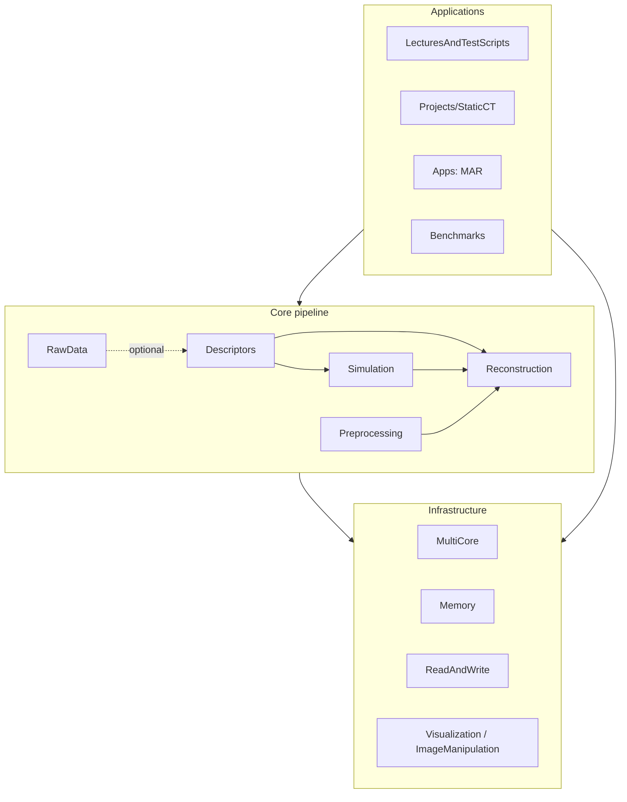

# Library Concept: Python CTBasics

The conceptual architecture of the library: what it models, how the parts fit together, and
which conventions hold everywhere. Read it before changing or extending the library.

**Living document.** Concept, structure, and conventions evolve with the library and may be
changed deliberately. Update this document in the same change whenever you add or move a
module, introduce a new data object or pipeline stage, or change a convention described here.
Coding rules are in [PythonSpecificCodingGuidelines.md](PythonSpecificCodingGuidelines.md);
setup and validation are in [AGENTS.md](AGENTS.md).

## 1. Purpose and scope

CTBasics simulates and reconstructs X-ray CT scans. Its main uses are teaching and
algorithm research:

- Voxel phantoms (static and moving), spectra, materials, and noise.
- Forward projection for parallel-beam, fan-beam (third-generation, rotating), and
  Static CT (stationary multi-source with a detector ring) geometries, in 2D and 3D
  (sequence and spiral).
- Rebinning from fan-beam or Static CT to parallel-beam, filtering, and weighted filtered
  backprojection (WFBP).
- Experiments built on these components: Static CT projects, metal artifact reduction (MAR),
  4D/cardiac motion, and dual source.

Out of scope for now: iterative reconstruction, GPU code, and a stable scanner raw-data
path (see section 9).

## 2. Origin

The library started as a port of the MATLAB CTBasics framework
([../../Matlab/siemens.CTBasics](../../Matlab/siemens.CTBasics)), which is kept unchanged and
no longer developed. The port was verified against MATLAB (about 1e-13 for deterministic
paths). **MATLAB is no longer the reference**: the Python library is developed on its own and
its concepts may depart from the original.

- Names of folders, files, classes, and methods still come from MATLAB, including original
  typos such as `Convovle3DSpiralSinogram`. They may be renamed as the design evolves.
- Bugs of the MATLAB original were ported verbatim to keep parity; they are listed in
  section 10 and can now be fixed.

## 3. Layered architecture

| Layer | Package | Responsibility | Key classes |
|---|---|---|---|
| Core | `Descriptors/` | What is scanned and how: geometry, scan parameters, sampling, volumes | `ScanDescriptor`, `FanBeam`, `ParallelBeam`, `StaticCTBeam`, `Spiral`, `Sequence`, `AzimuthalSampling`, `FlyingFocalSpot`, `Simulation`, `Reconstruction` |
| Core | `Simulation/` | Object and physics | `CreatePhantom`, `Noise`, `Spectra`, `SpectralProperties`, `Materials`, `MaterialProperties` |
| Core | `Reconstruction/` | Projection-domain and image-domain algorithms | `ForwardProjection`, `Rebinning`, `Kernels`, `MoireFilter`, `Convolution`, `Backprojection`, `Constants` |
| Core | `Preprocessing/` | Corrections of measured or simulated projections | `WBHC` (water beam-hardening correction) |
| Core (optional) | `RawData/` | Reading of scanner raw data into descriptors | `RawDataScanDescriptor`, `ReadRawDataFunctions`, `RawDataHelperFunctions` |
| Infrastructure | `MultiCore/` | Parallel execution and work partitioning | `Parallelization`, `CPU`, `RAM`, `Partition.SequenceStacks`, `Partition.SpiralStacks` |
| Infrastructure | `Memory/` | Working precision and allocation | `Precision`, `Allocation`, `TypeCast` |
| Infrastructure | `ReadAndWrite/` | Configuration, paths, file I/O, DICOM | `IOHelperFunctions` |
| Infrastructure | `Visualization/`, `ImageManipulation/` | Plots and image tools | |
| Applications | `LecturesAndTestScripts/`, `Projects/`, `Apps/`, `Benchmarks/`, `Scripts/` | Runnable scripts built on the core | `main(...)` per script |

Dependencies point downwards only: applications use the core and the infrastructure, and the
core uses the infrastructure. The core never imports from applications.

## 4. Core data model

### ScanDescriptor

`ScanDescriptor.Create(ScannerGeometryTypes.X, ScanTypes.Y)` returns a `ScanDescriptor`
with three parts:

- `Geometry`: the scanner geometry, a subclass of `BaseScannerGeometry`.
- `Parameter`: the scan protocol, a subclass of `BaseScanParameter`. It holds a reference to
  the same geometry.
- `Filename`: `"[virtual]"` for simulations, or the raw-data file name.

Geometry and parameter objects are plain classes with public attributes, mirroring MATLAB
handle classes. `Init()` sets the default values. `Copy()` makes a deep copy, and
`ScanDescriptor.Copy()` keeps the parameter-to-geometry link. `Load(...)` fills the object
from raw-data descriptors. Change a protocol through the setters, for example
`SetPitch`, `SetScanRange`, or `SetTableIncrement`, because they keep derived values
(`N`, `alphaN`, `zEndfocus`, ...) consistent.

| Geometry | Physical meaning | Main attributes |
|---|---|---|
| `FanBeam` | Rotating source with a cylindrical detector | `RF` focus–isocenter radius, `RD` isocenter–detector distance, `MFan` channels, `beta` fan angle per channel (decreasing), `Ns`/`ds`/`s0` detector rows, `c = Ns*ds` collimation, `RM` measurement-field radius, `gamma` anode angle, `FFS` flying focal spot, `Sampling` (`N2pi`, `dalpha`) |
| `StaticCTBeam` | Stationary source ring at `RF` outside a detector ring at `RD` | `MDelta`/`dDelta`/`delta0` ring detector elements, `betaMax`, collimator geometry, `soffset`, rows as above |
| `ParallelBeam` | Virtual parallel geometry. Stand-alone (`Init`) or derived from a fan/Static CT descriptor for rebinning (`ParallelBeam(Descriptor)`) | `M`, `xi0`, `dxi` channel coordinate; `theta0`, `dtheta`, `Npar` views; `RM` |

| Scan parameter | Main attributes |
|---|---|
| `Spiral` | `alpha0`, `alphaN`, `N` views, `z0focus`, `zEndfocus`, `pitch`, `zrot` (table feed per rotation) |
| `Sequence` | `NzScans` axial scans, `alpha0` (one start angle per scan), `alphaN`, `N`, `tableincrement`, `dzfocus` |

Volume descriptors:

- `Simulation(Descriptor)` defines the phantom grid: `Nxsim`, `dxsim`, `x0sim`, ...
- `Reconstruction(Descriptor, SimVolume)` defines the image grid: `Nx`, `dx`, `x0`, ...

Units: millimetres and radians.

### Arrays and index conventions

- Images are flat or 2D arrays in which x runs fastest: element (nx, ny, nz), counted 1-based
  as in MATLAB, sits at `(nz-1)*Nx*Ny + (ny-1)*Nx + nx-1`.
- 2D sinograms have shape `(N, M)`, i.e. views × channels.
- 3D projections are flat vectors in the order scan → view → detector row → channel, with
  the channel running fastest. The sequence block size is `M*N*Ns`.
- Angle loops run `n = 1..N`, so the first view is at `alpha0 + dalpha` (or
  `theta0 + dtheta`). Kernels keep MATLAB's 1-based index arithmetic internally, and every
  index shift is commented.

## 5. Processing pipeline

```mermaid
flowchart LR
    SD[ScanDescriptor.Create] --> VOL[Simulation / Reconstruction volumes]
    VOL --> PH[CreatePhantom.CreateVoxelPhantom2D/3D]
    PH --> FP[ForwardProjection.RayDriven...]
    FP --> N[Noise / WBHC, optional]
    N --> RB[Rebinning ...ToParallel..., fan and Static CT only]
    RB --> MF[MoireFilter, optional]
    MF --> K[Kernels.RamLakKernelSD / SheppLoganKernelSD]
    K --> C[Convolution.ConvolveSinogram / Convovle3D...]
    C --> BP[Backprojection PixDriven... / ...WFBP3D...]
    BP --> RES[Results dict, figures]
```

The functions come in two API levels:

1. **Explicit-parameter functions** such as `RayDrivenForwProjParCartesianMultiple`,
   `RebinningFanToParallel`, `ConvolveSinogram`, and `PixDrivenBackProjParCartesian`. They take
   every geometry value as an argument and are mainly used in 2D teaching scripts
   (`CTRecon101..103`, `TestScript2D`).
2. **Descriptor-level functions** such as `RayDrivenForwardProj3DFanSpiral`,
   `RebinningFanToParallelSequence`, and `SequenceWFBP3DFullyPixelDrivenParallelized`. They take
   a `ScanDescriptor`, a volume, and a `ParallelBeam` and are used in 3D
   (`TestScript3D`, `Projects/StaticCT`).

`Rebinning.Apply` and `Convolution.Apply` dispatch on beam type and scan type, and cache
their result in the output folder under a file name derived from the descriptor.

3D WFBP returns `(Image, Hxyz)`. `Hxyz` holds the accumulated backprojection weights.

## 6. Execution model and performance

- **Precision.** `Precision.Value(32|64)` is a global switch, with 64-bit as the default.
  `Allocation.zeros/ones` allocate in the active precision. Workers inherit it.
- **Process parallelism.** `Parallelization.Init(n)` replaces MATLAB's `parpool`; `Init(1)`
  runs serially. `Parallelization.ParFor(func, [sliced dicts], **broadcast)` replaces
  `parfor`. `func` must be picklable, i.e. a module function or a staticmethod. Results keep
  the serial order. `Parallelization.Chunks` serves reductions.
- **Thread parallelism.** Hot loops are numba kernels with
  `@numba.njit(parallel=True, cache=True)` placed at module level as private functions
  (`_ProjectParallelViews`, `_FanConeViews`, `_WFBP3D`, `_AzimuthalRebinning`, ...). They loop
  in MATLAB's order so that sums stay bit-identical or within about 1e-15. `Init(n)` also sets
  the numba thread count; workers use one thread.
- **Linear algebra.** Convolution uses a Toeplitz matrix product (BLAS) instead of loops.
- **Why this design.** The numpy kernels are limited by memory bandwidth, so process pools
  scale poorly. Thread-parallel numba kernels are 6–20× faster than MATLAB (i7-11850H,
  16 threads: e.g. `StaticCT3D` 70 s vs. 413 s, `TestScript3D` 30 s vs. 217 s, `CTRecon103`
  4.8 s vs. 59 s). The first run compiles the kernels; the cache
  is written to `__pycache__`, and editing a kernel module invalidates it.

## 7. Configuration and data

- `IOHelperFunctions()` reads `CTBasicsConfig.txt` from the folder in the environment variable
  `CTBASICS_CONFIG`, or else from `Documents/MATLAB` (OneDrive redirection is followed).
  Line 2 is the AI_Coding_Master root, line 4 the existing output folder, and line 6 the
  optional TFS toolbox path. A template is in
  [CTBasics/CTBasicsConfig.txt](CTBasics/CTBasicsConfig.txt).
- Shared input data (patient volumes, MAR and dual-energy data) lives in
  `AI_Coding_Master/Data/`. Derived results go to the output folder, never into the repository.

## 8. Scripts, tests, and validation

- **Scripts** are modules with `main(**flags)` that returns a `dict` of results, and they end
  with `if __name__ == "__main__":`. The flags keep the MATLAB names (`ShowFigures`,
  `SimNoise`, `Reconkernel`, ...). `RunAllScripts.py` runs them all, which is slow.
- **Tests** live in `tests/unit` (one file per domain) and `tests/integration` (end-to-end
  pipelines). `conftest.py` runs everything serially. Tests use tiny sizes and a temporary
  config.
- **Numerical changes** are checked against the previous Python results (regression on small
  sizes) and against physical or analytical expectations. MATLAB is no longer a reference.

## 9. Open points and roadmap

- Scanner raw data (`RawData/`, `TestScriptScannerData3D`, `FanBeam.Load`) depends on the
  MATLAB-only TFS toolbox (`readXACB`, ...) and is not ported functionally. Reading,
  reconstructing, and accelerating raw data will be redesigned as a whole.
- The spectral 3D forward projection is empty in MATLAB as well, so `TestScript3D` raises
  `NotImplementedError` for it.

## 10. Known issues inherited from MATLAB

Ported verbatim to keep parity. Each is a candidate for a fix; remove the entry when it is
fixed.

Reconstruction and simulation:

- `ForwardProjection.StaticCTCollimation*SourceSampled` sum the source samples without
  dividing by their count.
- `ForwardProjection.CalculateIntersectionPointsCircleAndLineIn2D_StaticCTGeo` returns `NaN`
  when the line misses the collimator circle; callers reject such rays.
- `Backprojection._WFBP3DVoxels` computes `l = sqrt((RF^2 - xi^2) - x*ss + y*cc)`; a negative
  radicand yields `NaN`.
- `Backprojection.SpiralWFBP3DFullyPixelDrivenParallelized_StaticCT` weights the cone angle
  with `RFD` (exact only for the centre beam) and sizes the last z window with `zStacksize`
  instead of `zStacksizeLast`.
- `Backprojection.SequenceWFBP3DFullyPixelDrivenParallelized_StaticCT` reconstructs the last
  z stack with the fan-beam `SequenceWFBP3DFullyPixelDriven`.
- `Spiral.SetScanRange` uses `max(Geometry.beta)` and therefore fails for `StaticCTBeam`.
- `ForwardProjection.RayDrivenForwProjParCartesianMultipleWithMotionDual_linear` allocates but
  never fills `PhantomTruth`; `..._Dual_ParallelSimple` sizes it `(N, M)`.
- `CreatePhantom`: `WaterWith4Arteries` negates the quarter condition for artery 4;
  `CreateVoxelPhantom2D('SimpleEllipseWithHips3D')` cannot work (raises `ValueError`).
- `ImageManipulation.Resample2D` uses the query grid `1:sz/N:sz`, which is not centred.

Applications and projects:

- `MAR.Apply` never removes the +1000 input shift; NMAR normalization adds 1000 to the line
  integrals. `MAR.MetalTraceInterpolation` raises `IndexError` at the detector border.
- `StaticCTSystemHelperFunctions.GreedyGapSamplingSubset(0, ...)` returns one angle.
- `CTRecon101DualSource` calls the projector with one argument missing (`TypeError`);
  `UseArbitraryOrder=True` is the working path.
- `StaticCT_4_ContrastmediaOrEmbo` recreates the loop-invariant ground truth inside the
  backprojection loop and leaves `ProjectionsGT` empty.
- `test_4DCT_prosp` always uses 2 subsets for the arbitrary angle order (`NSubsets` only
  labels the output).
- `NsourcesSweep` passes no `SelectedPhantom` (projector default `"Cardiac"`) and discards
  the Moire-filtered multi-source sinogram when `SimNoise` is on.
- `TestNoiseCardiac4DCT` hard-codes `Heartrate = 80` in the projector calls.

## 11. Where new code goes

| New functionality | Location |
|---|---|
| New scanner geometry | `Descriptors/Geometries/`, plus a branch in `ScanDescriptor.Create`, `ParallelBeam.__init__`, and the volume initialisers |
| New scan protocol | `Descriptors/ScanParameter/` |
| New phantom, motion, or physics effect | `Simulation/` (phantoms in `CreatePhantom`) |
| New projector, rebinning, kernel, or backprojector | Matching class in `Reconstruction/`; hot loop as a private numba kernel in the same module |
| Projection corrections | `Preprocessing/` |
| Experiment or study | `Projects/<Topic>/`. For Static CT, personal experiments go into `ProjectsAH`/`ProjectsCH`/`ProjectsJP`; shared helpers (`DualSource_*`, `StaticCT_*`) are collected in `StaticCTHelperFunctions/`, so check these before adding more |
| Teaching or verification script | `LecturesAndTestScripts/` |

Search for existing functionality first; see the general guidelines.
